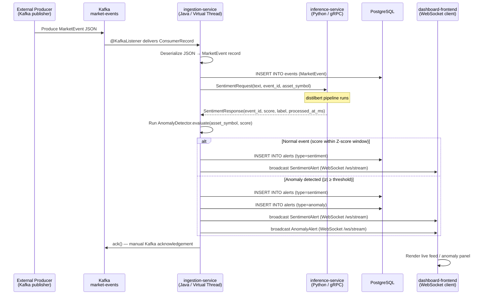

# InsightPulse — System Specification

> Real-time financial sentiment tracker and anomaly alerting microservices platform.
>
> Version: 1.1.0 | Date: 2026-10-15

---

## Table of Contents

1. [System Overview](#1-system-overview)
2. [Service Responsibilities](#2-service-responsibilities)
3. [Data Contracts](#3-data-contracts)
4. [Proto Definitions](#4-proto-definitions)
5. [Directory Skeleton](#5-directory-skeleton)
6. [Environment Variables](#6-environment-variables)
7. [Docker Compose Topology](#7-docker-compose-topology)
8. [Inter-Service Communication Flow](#8-inter-service-communication-flow)
9. [Technology Stack](#9-technology-stack)
10. [Architecture Decision Records](#10-architecture-decision-records)

---

## 1. System Overview

InsightPulse ingests raw market events from a Kafka topic, orchestrates ML sentiment scoring via a gRPC call to a Python model worker, runs anomaly detection, persists results to PostgreSQL, and streams live alerts to browser dashboards over WebSocket — all within a single Java/Spring Boot process acting as the central coordination engine.

### Architecture Diagram

```
  Market Data Feeds (external producers)
  ┌─────────────┐  ┌──────────────┐  ┌──────────────────┐
  │  News APIs  │  │ Social Media │  │ Market Data Feeds│
  └──────┬──────┘  └──────┬───────┘  └────────┬─────────┘
         └────────────────┴───────────────────┘
                                │
                                │  produces JSON to topic: market-events
                                ▼
                    ┌───────────────────────────┐
                    │         K A F K A         │
                    │    topic: market-events   │
                    └─────────────┬─────────────┘
                                  │  @KafkaListener (consumer group)
                                  ▼
          ┌───────────────────────────────────────────────┐
          │            ingestion-service                  │
          │            (Java 21 / Spring Boot 3)          │
          │                                               │
          │  ┌─────────────────────────────────────────┐  │
          │  │  Virtual Thread Pool  (Project Loom)    │  │
          │  │  ┌──────────────────────────────────┐   │  │
          │  │  │  MarketEventConsumer              │   │  │
          │  │  │  ├─ deserialize JSON → MarketEvent│   │  │
          │  │  │  ├─ call SentimentGrpcClient ─────┼───┼──┼──► inference-service
          │  │  │  │   (gRPC, port 50051)           │   │  │    (Python / gRPC only)
          │  │  │  ├─ run AnomalyDetector           │   │  │◄── SentimentResponse
          │  │  │  ├─ persist via EventRepository   │   │  │
          │  │  │  └─ dispatch via AlertDispatcher ──┼───┼──┼──► WebSocket /ws/stream
          │  │  └──────────────────────────────────┘   │  │
          │  └─────────────────────────────────────────┘  │
          │                                               │
          │  REST   GET  /api/alerts (historical)         │
          │  HTTP   GET  /health                          │
          │  HTTP   GET  /actuator/prometheus             │
          └───────────────────┬───────────────────────────┘
                              │
                 ┌────────────┴───────────┐
                 ▼                        ▼
          ┌────────────┐         ┌─────────────────┐
          │ PostgreSQL │         │dashboard-frontend│
          │  :5432     │         │ (Next.js / TS)  │
          │  events    │         │  /ws/stream      │
          │  alerts    │         │  ECharts         │
          └────────────┘         └─────────────────┘

  ┌──────────────────────────────────────┐
  │   inference-service (Python 3.11)    │
  │   gRPC server ONLY — port 50051      │
  │                                      │
  │   SentimentService.Analyze RPC       │
  │   ├─ load HuggingFace pipeline       │
  │   │    distilbert-base-uncased-      │
  │   │    finetuned-sst-2-english       │
  │   └─ return score [-1.0, 1.0]        │
  │                                      │
  │   No Kafka. No WebSocket. No DB.     │
  └──────────────────────────────────────┘
```

### Key Design Principles

| Principle | Implementation |
|---|---|
| **Single orchestrator** | `ingestion-service` (Java) owns the full event lifecycle — consume, enrich, persist, broadcast |
| **Stateless AI worker** | `inference-service` (Python) is a pure function: text in → score out over gRPC |
| **High concurrency, low overhead** | Virtual Threads (Project Loom) replace thread-pool blocking with lightweight carrier threads |
| **Strict type safety** | Proto3 IDL as the gRPC contract; Java records for internal domain objects; TypeScript interfaces on the frontend |
| **No cross-cutting responsibilities** | The Python service does not touch Kafka, PostgreSQL, WebSocket, or anomaly state |

---

## 2. Service Responsibilities

### 2.1 `ingestion-service` — Java 21 / Spring Boot 3 (Core Orchestrator)

This is the central coordination engine. Every event in the system flows through it.

| Responsibility | Detail |
|---|---|
| **Kafka consumption** | `@KafkaListener` subscribes to `market-events` (consumer group `ingestion-group`). Manual acknowledgement after successful processing. |
| **JSON deserialization** | Maps raw Kafka `ConsumerRecord<String, String>` to the typed `MarketEvent` record. Rejects malformed messages to DLQ. |
| **gRPC client** | Calls `inference-service:50051` via a blocking gRPC stub wrapped in a Virtual Thread. Deadline: 5 000 ms. |
| **Anomaly detection** | Maintains per-asset rolling Z-score state in memory (or Redis for multi-instance). Emits `AnomalyAlert` when `|z| ≥ threshold`. |
| **PostgreSQL persistence** | Writes every accepted `MarketEvent` to the `events` table and every produced alert to the `alerts` table via Spring Data JPA repositories. |
| **WebSocket server** | `AlertWebSocketHandler` at `/ws/stream` maintains a session registry and broadcasts `SentimentAlert` / `AnomalyAlert` JSON to all connected clients. |
| **REST API** | `GET /api/alerts` returns paginated historical alerts. `GET /health`. `GET /actuator/prometheus` for metrics scraping. |
| **Virtual Thread concurrency** | `spring.threads.virtual.enabled=true` maps each Kafka consumer callback to a Virtual Thread, eliminating platform thread starvation under high event throughput. |
| **Dead-letter queue** | Unprocessable events (deserialization failure, gRPC timeout, DB error) are published to `market-events-dlq`. |

### 2.2 `inference-service` — Python 3.11 (Stateless AI Worker)

This service has one job: accept a text payload over gRPC and return a sentiment score. It is intentionally isolated from all infrastructure concerns.

| Responsibility | Detail |
|---|---|
| **gRPC server** | Serves `SentimentService.Analyze` on port `50051` using `grpc.aio` (async). |
| **Model loading** | Loads `distilbert-base-uncased-finetuned-sst-2-english` from HuggingFace on startup. Model is cached in memory for the process lifetime. |
| **Score normalization** | Converts the raw pipeline output (`POSITIVE`/`NEGATIVE` + confidence) to a continuous `[-1.0, 1.0]` float. Formula: `score = confidence` if `POSITIVE`, `score = -confidence` if `NEGATIVE`. |
| **Health endpoint** | `GET /health` (HTTP, port `8000`) returns `{"status": "ok"}`. Used by Docker healthcheck and load balancers. |
| **No Kafka** | Does not subscribe to any topic. Events arrive exclusively via gRPC calls from `ingestion-service`. |
| **No WebSocket** | Does not hold any client connections. All real-time pushing is the responsibility of `ingestion-service`. |
| **No Database** | Does not read from or write to PostgreSQL. Stateless by design. |

### 2.3 `dashboard-frontend` — Next.js 14 / TypeScript

| Responsibility | Detail |
|---|---|
| **WebSocket client** | Connects to `ingestion-service` `/ws/stream`. Auto-reconnects with exponential back-off. |
| **Live sentiment feed** | Renders a scrolling list of incoming `SentimentAlert` messages colour-coded by `label`. |
| **Anomaly panel** | Highlights `AnomalyAlert` events with severity badges. |
| **Historical charts** | Fetches time-series sentiment data from `ingestion-service` `GET /api/alerts` REST endpoint. |
| **Asset filtering** | Filters the live feed by asset symbol on the client side. |
| **ECharts integration** | `SentimentChart` renders a live line chart over `SentimentAlert[]` using `echarts-for-react`. |

---

## 3. Data Contracts

> Data contracts are the authoritative definition of all messages exchanged between services.
> The TypeScript types below are canonical; the proto file (§4) and Java records (§5) must
> remain in sync with them.

### 3.1 `MarketEvent` — Kafka Message

Consumed by `ingestion-service`. Topic: `market-events`.

```typescript
type MarketEventSource =
  | "news_api"
  | "twitter"
  | "reddit"
  | "bloomberg_feed"
  | "reuters_feed";

type MarketEvent = {
  /** Globally unique event identifier (UUID v4) */
  event_id: string;

  /** ISO 8601 timestamp of when the source article/post was published */
  source_timestamp: string;

  /** ISO 8601 timestamp of when the event entered the Kafka topic */
  ingested_at: string;

  /** Ticker or asset symbol, e.g. "AAPL", "BTC-USD" */
  asset_symbol: string;

  /** Human-readable asset name, e.g. "Apple Inc." */
  asset_name: string;

  /** Raw text content to be analyzed (headline, tweet, post body, etc.) */
  text: string;

  /** URL of the original source document, if available */
  source_url: string | null;

  /** Enumerated origin of this event */
  source: MarketEventSource;

  /** Arbitrary key-value metadata from the source (preserved verbatim) */
  metadata: Record<string, unknown>;
};
```

### 3.2 `SentimentAlert` — WebSocket Push

Sent by `ingestion-service` → `dashboard-frontend`. Event type discriminant: `"sentiment_alert"`.

```typescript
type SentimentLabel = "positive" | "negative" | "neutral";

type SentimentAlert = {
  /** Discriminant for client-side message routing */
  type: "sentiment_alert";

  /** Matches the originating MarketEvent.event_id */
  event_id: string;

  /** Ticker or asset symbol */
  asset_symbol: string;

  /** Sentiment score in range [-1.0, 1.0]; negative = bearish, positive = bullish */
  score: number;

  /** Human-readable label derived from score thresholds */
  label: SentimentLabel;

  /** Unix epoch milliseconds when the inference model finished processing */
  processed_at_ms: number;

  /** ISO 8601 timestamp for display convenience */
  processed_at: string;

  /** Truncated source text (first 280 chars) for tooltip display */
  text_preview: string;
};
```

### 3.3 `AnomalyAlert` — WebSocket Push

Sent by `ingestion-service` → `dashboard-frontend`. Event type discriminant: `"anomaly_alert"`.

```typescript
type AnomalyAlert = {
  /** Discriminant for client-side message routing */
  type: "anomaly_alert";

  /** Unique identifier for this anomaly alert (UUID v4) */
  alert_id: string;

  /** Asset that triggered the anomaly */
  asset_symbol: string;

  /** Z-score magnitude that triggered this alert */
  z_score: number;

  /** Direction of the anomaly spike */
  direction: "bullish_spike" | "bearish_spike";

  /**
   * Severity derived from z_score:
   *   low    → |z| ∈ [2.0, 3.0)
   *   medium → |z| ∈ [3.0, 4.0)
   *   high   → |z| ≥ 4.0
   */
  severity: "low" | "medium" | "high";

  /** Rolling window size (number of events) used for Z-score computation */
  window_size: number;

  /** Mean sentiment score across the rolling window */
  window_mean: number;

  /** Standard deviation across the rolling window */
  window_stddev: number;

  /** The individual sentiment score that triggered the alert */
  triggering_score: number;

  /** event_id of the MarketEvent that triggered this anomaly */
  triggering_event_id: string;

  /** ISO 8601 timestamp when the anomaly was detected */
  detected_at: string;
};
```

### 3.4 `WebSocketMessage` — Discriminated Union

The frontend wire format. Every message pushed over `/ws/stream` is one of:

```typescript
type WebSocketMessage =
  | SentimentAlert   // type === "sentiment_alert"
  | AnomalyAlert;    // type === "anomaly_alert"
```

### 3.5 PostgreSQL Schema

```sql
-- ─────────────────────────────────────────────
-- Table: events
-- Written by: ingestion-service (Java)
-- ─────────────────────────────────────────────
CREATE TABLE IF NOT EXISTS events (
    event_id         UUID          PRIMARY KEY,
    source_timestamp TIMESTAMPTZ   NOT NULL,
    ingested_at      TIMESTAMPTZ   NOT NULL DEFAULT NOW(),
    asset_symbol     VARCHAR(20)   NOT NULL,
    asset_name       VARCHAR(255)  NOT NULL,
    text             TEXT          NOT NULL,
    source_url       TEXT,
    source           VARCHAR(50)   NOT NULL,
    metadata         JSONB         NOT NULL DEFAULT '{}'
);

CREATE INDEX idx_events_asset_symbol ON events (asset_symbol);
CREATE INDEX idx_events_ingested_at  ON events (ingested_at DESC);
CREATE INDEX idx_events_source       ON events (source);

-- ─────────────────────────────────────────────
-- Table: alerts
-- Written by: ingestion-service (Java)
-- ─────────────────────────────────────────────
CREATE TYPE alert_type_enum   AS ENUM ('sentiment', 'anomaly');
CREATE TYPE sentiment_label   AS ENUM ('positive', 'negative', 'neutral');
CREATE TYPE anomaly_direction AS ENUM ('bullish_spike', 'bearish_spike');
CREATE TYPE anomaly_severity  AS ENUM ('low', 'medium', 'high');

CREATE TABLE IF NOT EXISTS alerts (
    alert_id            UUID              PRIMARY KEY DEFAULT gen_random_uuid(),
    alert_type          alert_type_enum   NOT NULL,
    event_id            UUID              NOT NULL REFERENCES events (event_id),
    asset_symbol        VARCHAR(20)       NOT NULL,
    processed_at        TIMESTAMPTZ       NOT NULL,

    -- sentiment-specific columns (NULL for anomaly alerts)
    sentiment_score     FLOAT,
    sentiment_label     sentiment_label,

    -- anomaly-specific columns (NULL for sentiment alerts)
    z_score             FLOAT,
    direction           anomaly_direction,
    severity            anomaly_severity,
    window_size         INT,
    window_mean         FLOAT,
    window_stddev       FLOAT,

    created_at          TIMESTAMPTZ       NOT NULL DEFAULT NOW()
);

CREATE INDEX idx_alerts_asset_symbol ON alerts (asset_symbol);
CREATE INDEX idx_alerts_alert_type   ON alerts (alert_type);
CREATE INDEX idx_alerts_processed_at ON alerts (processed_at DESC);
CREATE INDEX idx_alerts_event_id     ON alerts (event_id);
```

---

## 4. Proto Definitions

The proto file is the contract between `ingestion-service` (gRPC client) and `inference-service`
(gRPC server). Both sides must be compiled from the same source.

File: `proto/sentiment.proto` (shared root) — also copied to:
- `ingestion-service/src/main/proto/sentiment.proto` (Gradle protobuf plugin compiles this)
- `inference-service/proto/sentiment.proto` (`grpc_tools.protoc` generates Python stubs)

```protobuf
syntax = "proto3";

package sentiment;

option java_package         = "com.insightpulse.proto";
option java_multiple_files  = true;
option java_outer_classname = "SentimentProto";

// ─────────────────────────────────────────────
// Messages
// ─────────────────────────────────────────────

message SentimentRequest {
  // Raw text to analyze (headline, tweet body, etc.)
  string text         = 1;

  // UUID of the originating MarketEvent
  string event_id     = 2;

  // Asset ticker the text relates to, e.g. "AAPL"
  string asset_symbol = 3;
}

message SentimentResponse {
  // UUID echoed from the request for correlation
  string event_id        = 1;

  // Normalized sentiment score in range [-1.0, 1.0]
  // positive → bullish, negative → bearish
  float  score           = 2;

  // Human-readable label: "positive" | "negative" | "neutral"
  string label           = 3;

  // Unix epoch milliseconds when the model finished inference
  int64  processed_at_ms = 4;
}

// ─────────────────────────────────────────────
// Service
// ─────────────────────────────────────────────

service SentimentService {
  // Analyze performs sentiment inference on a single text payload.
  //
  // Called by: ingestion-service (Java, blocking stub in Virtual Thread)
  // Served by: inference-service (Python, grpc.aio)
  //
  // Clients SHOULD set a deadline of 5 000 ms.
  // On deadline exceeded, ingestion-service publishes to DLQ.
  rpc Analyze (SentimentRequest) returns (SentimentResponse);
}
```

---

## 5. Directory Skeleton

```
insight-pulse/
├── docker-compose.yml
├── .env.example
├── .gitignore
├── README.md
├── SPECIFICATION.md
│
├── proto/                                    # shared IDL — single source of truth
│   └── sentiment.proto
│
├── ingestion-service/                        # Java 21 / Spring Boot 3 — CORE ORCHESTRATOR
│   ├── Dockerfile
│   ├── build.gradle.kts
│   ├── settings.gradle.kts
│   ├── .env.example
│   ├── .dockerignore
│   ├── gradle/
│   │   └── wrapper/
│   │       └── gradle-wrapper.properties
│   └── src/
│       ├── main/
│       │   ├── proto/
│       │   │   └── sentiment.proto           # symlink or copy of /proto/sentiment.proto
│       │   ├── resources/
│       │   │   ├── application.yml
│       │   │   └── db/migration/
│       │   │       ├── V1__create_events.sql
│       │   │       └── V2__create_alerts.sql
│       │   └── java/com/insightpulse/ingestion/
│       │       ├── IngestionServiceApplication.java
│       │       ├── config/
│       │       │   ├── KafkaConfig.java      # consumer factory, error handler
│       │       │   ├── WebSocketConfig.java  # registers /ws/stream endpoint
│       │       │   └── GrpcClientConfig.java # ManagedChannel bean
│       │       ├── model/
│       │       │   ├── MarketEvent.java      # record — canonical domain type
│       │       │   ├── SentimentAlert.java   # record
│       │       │   └── AnomalyAlert.java     # record
│       │       ├── entity/
│       │       │   ├── EventEntity.java      # @Entity mapped to events table
│       │       │   └── AlertEntity.java      # @Entity mapped to alerts table
│       │       ├── repository/
│       │       │   ├── EventRepository.java  # JpaRepository<EventEntity, UUID>
│       │       │   └── AlertRepository.java  # JpaRepository<AlertEntity, UUID>
│       │       ├── kafka/
│       │       │   └── MarketEventConsumer.java  # @KafkaListener — entry point
│       │       ├── grpc/
│       │       │   └── SentimentGrpcClient.java  # wraps blocking stub, handles deadlines
│       │       ├── anomaly/
│       │       │   └── AnomalyDetector.java  # per-asset rolling Z-score state
│       │       ├── websocket/
│       │       │   └── AlertWebSocketHandler.java # extends TextWebSocketHandler
│       │       ├── service/
│       │       │   ├── AlertDispatchService.java  # interface
│       │       │   └── AlertDispatchServiceImpl.java
│       │       └── controller/
│       │           └── AlertController.java   # GET /api/alerts, GET /health
│       └── test/
│           └── java/com/insightpulse/ingestion/
│               ├── IngestionServiceApplicationTests.java
│               ├── kafka/
│               │   └── MarketEventConsumerTest.java
│               ├── grpc/
│               │   └── SentimentGrpcClientTest.java
│               └── anomaly/
│                   └── AnomalyDetectorTest.java
│
├── inference-service/                        # Python 3.11 — STATELESS AI WORKER (gRPC only)
│   ├── Dockerfile
│   ├── pyproject.toml
│   ├── requirements.txt
│   ├── .env.example
│   ├── .dockerignore
│   ├── proto/
│   │   └── sentiment.proto                   # copy of /proto/sentiment.proto
│   ├── scripts/
│   │   └── generate_proto.sh                 # runs grpc_tools.protoc → proto_generated/
│   └── inference_service/
│       ├── __init__.py
│       ├── main.py                           # FastAPI app + lifespan (loads model, starts gRPC)
│       ├── config.py                         # pydantic BaseSettings
│       ├── proto_generated/
│       │   ├── .gitkeep                      # populated by generate_proto.sh
│       │   ├── sentiment_pb2.py              # (generated)
│       │   └── sentiment_pb2_grpc.py         # (generated)
│       ├── model/
│       │   ├── __init__.py
│       │   └── sentiment_model.py            # load(), predict(text) → float
│       ├── grpc_server/
│       │   ├── __init__.py
│       │   ├── servicer.py                   # SentimentServicer(SentimentServiceServicer)
│       │   └── server.py                     # create_grpc_server() → grpc.aio.Server
│       └── api/
│           ├── __init__.py
│           ├── schemas.py                    # Pydantic: SentimentRequest, SentimentResponse
│           └── routes/
│               ├── __init__.py
│               └── health.py                 # GET /health
│
└── dashboard-frontend/                       # Next.js 14 / TypeScript — LIVE DASHBOARD
    ├── Dockerfile
    ├── package.json
    ├── tsconfig.json
    ├── tailwind.config.ts
    ├── next.config.ts
    ├── .env.local.example
    ├── .dockerignore
    └── src/
        ├── types/
        │   └── market.ts                     # MarketEvent, SentimentAlert, AnomalyAlert, WebSocketMessage
        ├── lib/
        │   ├── constants.ts                  # WS_ENDPOINT, API_BASE_URL
        │   └── websocket.ts                  # WebSocketClient class (reconnect logic)
        ├── hooks/
        │   ├── useAlertStream.ts             # subscribes to SENTIMENT messages
        │   └── useAnomalyAlerts.ts           # subscribes to ANOMALY messages
        └── app/
            ├── globals.css
            ├── layout.tsx
            ├── page.tsx
            └── dashboard/
                └── page.tsx
        └── components/
            ├── dashboard/
            │   ├── DashboardLayout.tsx
            │   ├── SentimentChart.tsx        # echarts-for-react line chart
            │   ├── AlertFeed.tsx
            │   ├── AnomalyPanel.tsx
            │   └── ConnectionStatusBadge.tsx
            └── ui/
                ├── Badge.tsx
                └── Card.tsx
```

---

## 6. Environment Variables

### 6.1 `ingestion-service` (Java / Spring Boot)

| Variable | Required | Default | Description |
|---|---|---|---|
| `SERVER_PORT` | no | `8080` | HTTP / WebSocket server port |
| `SPRING_PROFILES_ACTIVE` | no | `default` | Active Spring profile |
| `KAFKA_BOOTSTRAP_SERVERS` | yes | — | Broker list, e.g. `kafka:9092` |
| `KAFKA_CONSUMER_GROUP_ID` | no | `ingestion-group` | Kafka consumer group |
| `KAFKA_TOPIC_MARKET_EVENTS` | no | `market-events` | Source topic name |
| `KAFKA_TOPIC_DLQ` | no | `market-events-dlq` | Dead-letter topic name |
| `GRPC_INFERENCE_HOST` | yes | — | Hostname of `inference-service`, e.g. `inference-service` |
| `GRPC_INFERENCE_PORT` | no | `50051` | gRPC server port |
| `GRPC_DEADLINE_MS` | no | `5000` | Per-call gRPC deadline in milliseconds |
| `POSTGRES_HOST` | yes | — | PostgreSQL hostname |
| `POSTGRES_PORT` | no | `5432` | PostgreSQL port |
| `POSTGRES_DB` | yes | — | Database name |
| `POSTGRES_USER` | yes | — | Database user |
| `POSTGRES_PASSWORD` | yes | — | Database password |
| `ANOMALY_WINDOW_SIZE` | no | `50` | Rolling window length for Z-score |
| `ANOMALY_Z_THRESHOLD` | no | `2.0` | Z-score threshold to trigger anomaly |
| `WS_MAX_SESSIONS` | no | `500` | Max concurrent WebSocket sessions |

### 6.2 `inference-service` (Python / gRPC only)

| Variable | Required | Default | Description |
|---|---|---|---|
| `GRPC_PORT` | no | `50051` | Port for the gRPC server |
| `HTTP_PORT` | no | `8000` | Port for the FastAPI health endpoint |
| `MODEL_NAME` | no | `distilbert-base-uncased-finetuned-sst-2-english` | HuggingFace model identifier |
| `MODEL_CACHE_DIR` | no | `/tmp/hf_cache` | Local directory for downloaded model weights |
| `LOG_LEVEL` | no | `INFO` | Python log level |
| `GRPC_MAX_WORKERS` | no | `4` | Thread pool size for non-async gRPC handlers |

### 6.3 `dashboard-frontend` (Next.js)

| Variable | Required | Default | Description |
|---|---|---|---|
| `NEXT_PUBLIC_WS_ENDPOINT` | yes | — | WebSocket URL, e.g. `ws://localhost:8080/ws/stream` |
| `NEXT_PUBLIC_API_BASE_URL` | yes | — | ingestion-service REST base URL, e.g. `http://localhost:8080` |
| `NEXT_PUBLIC_WS_RECONNECT_DELAY_MS` | no | `3000` | Base delay between reconnect attempts |
| `NEXT_PUBLIC_MAX_FEED_ITEMS` | no | `200` | Max items kept in live feed state |

---

## 7. Docker Compose Topology

File: `docker-compose.yml`

The local stack runs on a single bridge network (`insightpulse-net`). The Python
`inference-service` is intentionally isolated — it has no access to Kafka or Postgres.

```
┌──────────────────────────────────────────────────────────────────┐
│                    insightpulse-net (bridge)                     │
│                                                                  │
│  ┌─────────────┐   ┌──────────────────┐   ┌────────────────┐   │
│  │  zookeeper  │   │      kafka       │   │   kafka-ui     │   │
│  │  :2181      │──►│  :9092  (int)    │   │   :8090        │   │
│  └─────────────┘   │  :29092 (ext)    │   └────────────────┘   │
│                    └────────┬─────────┘                         │
│                             │ market-events                     │
│                             │ (consumed by ingestion-service)   │
│                             ▼                                   │
│  ┌──────────────┐   ┌───────────────────────────────────────┐  │
│  │  postgres    │   │         ingestion-service             │  │
│  │  :5432       │◄──┤         (Java / Spring Boot)          │  │
│  └──────────────┘   │         :8080  HTTP + WS              │  │
│                     │                 │                      │  │
│                     │    gRPC :50051  │                      │  │
│                     └─────────────────┼──────────────────────┘  │
│                                       │                         │
│                                       ▼                         │
│                     ┌─────────────────────────────────────┐     │
│                     │        inference-service            │     │
│                     │        (Python / gRPC only)         │     │
│                     │        :50051 gRPC                  │     │
│                     │        :8000  HTTP health only      │     │
│                     └─────────────────────────────────────┘     │
│                                                                  │
│  ┌──────────────────────────────────────────────────────────┐   │
│  │  dashboard-frontend  (Next.js)  :3000                    │   │
│  │  WebSocket client → ingestion-service:8080/ws/stream     │   │
│  └──────────────────────────────────────────────────────────┘   │
└──────────────────────────────────────────────────────────────────┘
```

**Service definitions summary:**

| Service | Image / Build | Ports | Depends On | Notes |
|---|---|---|---|---|
| `zookeeper` | `confluentinc/cp-zookeeper:7.5.0` | `2181` | — | |
| `kafka` | `confluentinc/cp-kafka:7.5.0` | `9092`, `29092` | `zookeeper` | Auto-creates `market-events` (3 partitions, RF=1) |
| `kafka-ui` | `provectuslabs/kafka-ui:latest` | `8090` | `kafka` | |
| `postgres` | `postgres:16-alpine` | `5432` | — | `insightpulse` DB |
| `ingestion-service` | `build ./ingestion-service` | `8080` | `kafka`, `postgres` | Connects to `inference-service:50051` |
| `inference-service` | `build ./inference-service` | `8000`, `50051` | — | **No Kafka, no Postgres** |
| `dashboard-frontend` | `build ./dashboard-frontend` | `3000` | `ingestion-service` | |

**Volumes:**

- `postgres-data` → `/var/lib/postgresql/data`
- `kafka-data` → `/var/lib/kafka/data`

**Health checks** are defined on `postgres`, `kafka`, and `inference-service` so that
`ingestion-service` only starts once all its dependencies are healthy.

---

## 8. Inter-Service Communication Flow

### 8.1 Mermaid Sequence Diagram



### 8.2 ASCII Fallback

```
External Kafka Producer
        │
        │  JSON MarketEvent → topic: market-events
        ▼
   Kafka Broker
        │
        │  @KafkaListener (Virtual Thread)
        ▼
ingestion-service (Java)
  │
  ├─► INSERT INTO events ─────────────────────────────► PostgreSQL
  │
  ├─► gRPC SentimentRequest ──────────────────────────► inference-service (Python)
  │   ◄── SentimentResponse (score, label) ────────────
  │
  ├─► AnomalyDetector.evaluate()
  │       │
  │       ├── score normal ──► INSERT alerts(sentiment) ► PostgreSQL
  │       │                    broadcast SentimentAlert  ► /ws/stream
  │       │
  │       └── anomaly ──────► INSERT alerts(sentiment)  ► PostgreSQL
  │                           INSERT alerts(anomaly)    ► PostgreSQL
  │                           broadcast SentimentAlert  ► /ws/stream
  │                           broadcast AnomalyAlert    ► /ws/stream
  │
  └─► ack() ─────────────────────────────────────────► Kafka (manual commit)

/ws/stream ──────────────────────────────────────────► dashboard-frontend
                                                        (Next.js WebSocket client)
```

### 8.3 gRPC Call Contract

| Property | Value |
|---|---|
| Protocol | gRPC over HTTP/2 (plaintext in local dev; TLS in production) |
| Service | `SentimentService.Analyze` |
| Caller | `ingestion-service` — blocking stub, wrapped in Virtual Thread |
| Server | `inference-service` — `grpc.aio` async servicer |
| Deadline | 5 000 ms (configurable via `GRPC_DEADLINE_MS`) |
| On timeout | `ingestion-service` publishes event to `market-events-dlq` |
| Retry | Single attempt; retry policy deferred to dead-letter reprocessor |

---

## 9. Technology Stack

| Layer | Technology | Version | Service | Purpose |
|---|---|---|---|---|
| **Language** | Java | 21 LTS | ingestion-service | Core application language |
| **Runtime concurrency** | Project Loom (Virtual Threads) | JDK 21 GA | ingestion-service | Lightweight per-request threads replacing platform thread pools |
| **Framework** | Spring Boot | 3.2.x | ingestion-service | DI, Kafka, WebSocket, JPA, Actuator |
| **Kafka client** | Spring Kafka | 3.1.x | ingestion-service | `@KafkaListener`, `KafkaTemplate` |
| **gRPC client (Java)** | grpc-spring-boot-starter (net.devh) | 3.1.x | ingestion-service | `ManagedChannel` + auto-wired blocking stub |
| **gRPC stubs (Java)** | protobuf-java + grpc-stub | 1.63.x | ingestion-service | Generated from `sentiment.proto` |
| **ORM** | Spring Data JPA / Hibernate | 3.2.x | ingestion-service | PostgreSQL repositories |
| **DB driver (Java)** | PostgreSQL JDBC | 42.x | ingestion-service | JDBC connectivity |
| **Build tool** | Gradle (Kotlin DSL) | 8.5 | ingestion-service | Build, protobuf plugin |
| **Language** | Python | 3.11 | inference-service | gRPC worker language |
| **gRPC server (Python)** | grpcio + grpcio-tools | 1.63.x | inference-service | Async gRPC server (`grpc.aio`) |
| **Proto codegen (Python)** | grpc_tools.protoc | 1.63.x | inference-service | Generates `_pb2.py` stubs |
| **ML framework** | HuggingFace Transformers | 4.x | inference-service | `pipeline("sentiment-analysis")` |
| **ML model** | distilbert-base-uncased-finetuned-sst-2-english | — | inference-service | Sentiment classification, 66M params |
| **HTTP health (Python)** | FastAPI + uvicorn | 0.111.x / 0.29.x | inference-service | `GET /health` only |
| **Settings (Python)** | Pydantic BaseSettings | 2.x | inference-service | Env-driven configuration |
| **Language** | TypeScript | 5.x | dashboard-frontend | Frontend type safety |
| **Framework** | Next.js | 14.x (App Router) | dashboard-frontend | SSR + client components |
| **Styling** | Tailwind CSS | 3.x | dashboard-frontend | Utility-first CSS |
| **Charts** | Apache ECharts + echarts-for-react | 5.x / 3.x | dashboard-frontend | Live time-series, heatmaps |
| **Message broker** | Apache Kafka (Confluent) | 7.5.x | infrastructure | Durable event streaming |
| **Database** | PostgreSQL | 16 | infrastructure | Persistent storage for events + alerts |
| **Containerisation** | Docker + Docker Compose | 27.x / 2.x | infrastructure | Local dev environment |
| **Proto IDL** | Protocol Buffers | proto3 | cross-cutting | gRPC service contract |
| **Observability** | Spring Actuator + Prometheus | — | ingestion-service | Metrics endpoint |

---

## 10. Architecture Decision Records

### ADR-001: Java as the Single Orchestration Engine

**Decision:** `ingestion-service` (Java/Spring Boot) owns the complete event lifecycle — Kafka consumption, gRPC dispatch, anomaly detection, PostgreSQL writes, and WebSocket broadcasting. The Python service is a pure gRPC worker with no other responsibilities.

**Rationale:**
- Spring Boot provides first-class integration for all required capabilities (Kafka, gRPC client, WebSocket, JPA) in a single, well-tested framework.
- Concentrating orchestration logic in one process eliminates a distributed state problem: anomaly detection requires mutable per-asset rolling windows, which would require a shared cache (Redis) if split across services.
- Virtual Threads (JDK 21) remove the traditional argument for Python/async in I/O-bound workloads — the Java service can hold thousands of concurrent Kafka partitions and WebSocket sessions with minimal overhead.

**Trade-off:** The Java service is a wider blast radius for failures. Mitigation: health checks, Kafka manual acknowledgement, and the DLQ pattern ensure no events are silently dropped.

### ADR-002: Python inference-service is Stateless by Design

**Decision:** The Python service accepts gRPC calls, runs the HuggingFace pipeline, and returns a score. It touches no external systems.

**Rationale:**
- HuggingFace Transformers, PyTorch, and the broader ML ecosystem are Python-native. Running the model in Java would require JNI bridging (ONNX Runtime) — additional complexity for no architectural benefit.
- A stateless gRPC worker is trivially horizontally scalable: run N replicas behind a load balancer, each holding a copy of the model weights in memory.
- Keeping the Python service free of Kafka/DB dependencies means it can be upgraded, replaced, or swapped for a different model without touching the ingestion pipeline.

**Trade-off:** Every inference call crosses a network boundary (gRPC). Mitigation: the 5 000 ms deadline and DLQ ensure the ingestion pipeline is never blocked indefinitely.

### ADR-003: Virtual Threads over Reactive Programming

**Decision:** Use `spring.threads.virtual.enabled=true` (Project Loom) rather than Spring WebFlux / Project Reactor for concurrency.

**Rationale:**
- Virtual Threads provide the concurrency benefits of reactive programming (no platform thread blocking on I/O) with imperative, synchronous code that is easier to reason about and debug.
- Spring Boot 3.2 integrates Virtual Threads transparently — `@KafkaListener`, JDBC calls, and gRPC blocking stubs all benefit without code changes.
- Reactive streams would require every layer (Kafka, gRPC, JPA) to expose reactive APIs, significantly increasing boilerplate and cognitive overhead.

---

*Generated: 2026-10-15 | InsightPulse v1.1.0*
